# WinSysLive Documentation

WinSysLive shows a live view of a Windows system: processes and everything inside them, performance, services and
drivers, users, network connections, kernel modules, RPC/ALPC traffic, the object manager, kernel pools, disk I/O and
more, with the tools to act on them.

This document describes every tab, dialog and option. For installation, see the [README](../README.md).

## Contents

- [Getting started](#getting-started)
- [The main window](#the-main-window)
- [Processes](#processes)
- [Process properties](#process-properties)
- [Services](#services)
- [Performance](#performance)
- [Users](#users)
- [Network](#network)
- [Kernel Modules](#kernel-modules)
- [Drivers](#drivers)
- [RPC/ALPC](#rpcalpc)
- [Zombie Processes](#zombie-processes)
- [Object Types](#object-types)
- [Object Manager](#object-manager)
- [Pool Tags](#pool-tags)
- [Disk](#disk)
- [History](#history)
- [Find Handle or DLL](#find-handle-or-dll)
- [File menu: Run and Run As](#file-menu-run-and-run-as)
- [System menu](#system-menu)
- [Computer menu](#computer-menu)
- [Tools menu](#tools-menu)
- [Options](#options)
- [Symbols](#symbols)
- [VirusTotal](#virustotal)
- [Updates](#updates)
- [Keyboard shortcuts](#keyboard-shortcuts)
- [What needs elevation](#what-needs-elevation)

## Getting started

Run `WinSysLive.exe`. It works without administrator rights, but much of what it shows (other users' processes,
network traffic, RPC/ALPC, pool tags, physical memory...) needs it to run elevated. **File > Run as Administrator**
restarts it elevated. To start it elevated every time without a UAC prompt, use **Options > Run at Windows Startup
(Elevated)**, or let it replace Task Manager (see [Options](#options)).

Keep `dbghelp.dll` and `symsrv.dll` (included in the release zip) beside the exe: without them, symbols can't be
downloaded from a symbol server.

## The main window

The window holds tabs. **Processes** is always open; the others open and close from the **View** menu (or the toolbar's
buttons, or their shortcuts): choosing a closed tab opens it, choosing an open tab that isn't active activates it, and
choosing the active tab closes it. A tab's close button closes it too. Drag tabs to reorder them. The open tabs, their
order and the active one are remembered.

Everything refreshes together at the **update interval** (View > Update Interval: 0.5, 1, 2 or 5 seconds).
**View > Pause Updates** (Space) stops refreshing; **View > Refresh** (F5) refreshes once.

Common to the list tabs:

- **Filter box** above the list (Ctrl+F focuses it): the rows that contain the text, case-insensitively, in the columns
  the tab describes. Escape clears it; Enter or Down goes to the list.
- **Columns:** right-click a column header to hide it or choose columns; drag headers to reorder them. The layout and
  widths are remembered per tab. Click a header to sort; click it again to reverse.
- **Highlighting:** new items are green and removed ones red for a few seconds (Options > Highlighting...).
- **Copy** (Ctrl+C) copies the selected rows' shown columns, tab separated. **Copy All Rows** (Ctrl+Shift+C) copies the
  whole list; **File > Export List** (Ctrl+S) saves it as CSV or tab-separated text.
- **Properties** (Alt+Enter) or a double-click opens the selected item's details where there are any.
- **Kill** (the toolbar's button, or Delete) acts on the list with the focus: it kills a process, terminates a thread or
  closes a handle. Its tooltip says which.

The toolbar also has the **window finder**: drag the target button onto any window to select its process in the
Processes tab, as in Process Explorer. While dragging, the window is outlined and named in the status bar; Escape
cancels.

## Processes

The processes as a tree (each under its parent) or a flat list (**View > Process Tree**, Ctrl+T), colored by kind.

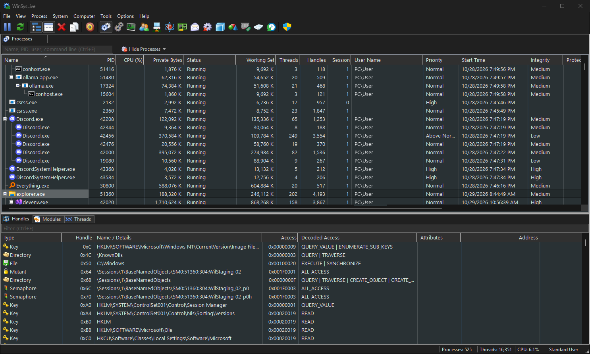

### Row colors

Each process gets the color of the first kind that applies, in this order: Exited, New, Suspended, Secure (IUM),
Protected, Immersive (Store apps), .NET, Services, Jobs, Own (your own processes). **Options > Process Colors...** turns
each kind on or off and sets its light and dark mode colors.

### Columns

**View > Select Columns...** opens a tree of the columns by category:

| Category | Columns |
|---|---|
| General | Name, PID, Parent PID, Parent Name, Status, Session, User Name, Start Time, Architecture, DPI Awareness, Package Name, Window Title, Description, Image Path, Command Line |
| CPU | CPU (%), CPU Time, Kernel Time, User Time, CPU Cycles, Ctx Switches, Ctx Switch Delta, Threads, Peak Threads, Priority, CPU History |
| Memory | Private Bytes, Private Bytes Delta, Peak Private Bytes, Working Set, Peak Working Set, Virtual Size, Page Faults, Paged Pool, Non-Paged Pool, Memory Priority, Private Bytes History |
| I/O | I/O Pri, I/O Read Bytes, I/O Write Bytes, I/O Other Bytes, I/O History |
| Network | Network Send Bytes, Network Recv Bytes, Network History |
| GPU and NPU | GPU (%), Dedicated GPU Memory, Shared GPU Memory, NPU (%), NPU Memory |
| Handles and Objects | Handles, GDI Objects, Peak GDI Objects, User Objects, Peak User Objects |
| Security | Integrity, Elevated, Protection, Critical, CFG, Mitigations, UAC Virtualization, Job ID, VirusTotal |

Notes:

- **Status** is Task Manager's: Running, Suspended or Not responding.
- The **History** columns draw a small graph per process; hover over one for its last, minimum, maximum and average.
- The **Network** columns need elevation (they come from an ETW trace).
- Columns that need the process opened are empty for processes WinSysLive can't open (other users' and protected
  processes, when not elevated).

### Filtering and hiding

The filter box matches the image name, PID, user, description and command line. A matching process's ancestors stay
in the tree, grayed. **View > Hide Processes** (also the Hide button beside the filter) hides other users' processes,
services, Windows processes and signed processes (by a verified signature).

**View > Keep Selection Visible** scrolls to the selected process on every update instead of keeping the scroll
position.

### Lower pane

**View > Lower Pane** (Ctrl+L) shows the selected process's **Threads**, **Modules** and **Handles** below the list.
Each page has its own filter box, columns and Copy.

- **Threads:** CPU, context switches and their deltas, state, priorities, start address (with its symbol), service
  (for service hosts) and more. The context menu has **Stack** (also a double-click: the call stack with symbols),
  **Wait Chain...**, **Set Priority**, **Affinity...**, **Suspend**, **Resume** and **Terminate**.
- **Modules:** loaded images and mapped data files with their version information. Properties opens the shell's file
  properties; Open File Location opens the folder.
- **Handles:** the process's handles with their types, names, access (decoded) and, while the Address column is shown,
  the kernel object addresses (elevated). **View > Show Unnamed Handles** shows or hides handles without a name.
  Properties (or a double-click) opens the **handle sheet**: general information, the object's type-specific details
  (event state, mutex owner, section, file, key, token...) and its security (the system's permissions editor). Close
  Handle closes the handle in its process.

### Process commands

The **Process** menu and the row context menu:

| Command | What it does |
|---|---|
| Kill Process | Terminates the process |
| Kill Process Tree | Terminates the process and all its descendants |
| Kill All with the Same Name | Terminates every process with the same image name |
| Restart | Terminates the process and starts it again with the same command line, directory, environment, user and elevation (not for services, packaged apps or WinSysLive itself) |
| Suspend / Resume | Suspends or resumes all the process's threads |
| Set Priority, I/O Priority, Memory Priority | Sets the priority; the current one is checked |
| Set Affinity... | Chooses the processors it may run on (by processor group on systems with more than 64 processors) |
| Efficiency Mode | Low priority and EcoQoS, as Task Manager's |
| Reduce Working Set | Empties the working set |
| Advanced > Critical Process | Marks or unmarks the process critical (elevated; Windows crashes when a critical process exits) |
| Advanced > Inject DLL... | Loads a DLL into the process (64-bit processes only) |
| Debug | Attaches the registered postmortem debugger (AeDebug) |
| Analyze Wait Chain... | What the process's threads wait for, deadlocks first (red) |
| Create Dump | Writes a minidump or a full dump |
| Open File Location | Opens the image's folder with the file selected |
| VirusTotal | Open Report, Check Again, Submit File... (see [VirusTotal](#virustotal)) |
| Find Handle or DLL... | See [Find Handle or DLL](#find-handle-or-dll) |

## Process properties

Double-click a process (or Alt+Enter, or Properties in the context menu) to open its property sheet. Each sheet is a
separate window with its own taskbar button and stays open while you keep working. It has these pages:

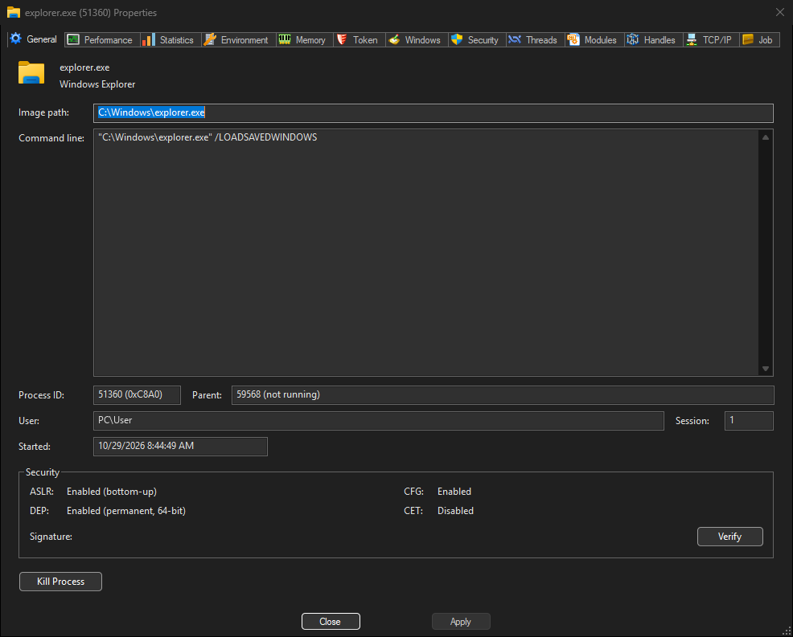

| Page | Contents |
|---|---|
| General | Image, command line, directories, parent, user, start time, architecture, mitigations (ASLR, CFG, CET, DEP); signature verification; Kill |
| Statistics | CPU, memory, I/O, handles and GUI objects counters, with their peaks and the change since the last update |
| Performance | CPU, memory, I/O and network graphs of the process since the sheet opened |
| Threads, Modules, Handles | As in the lower pane |
| Memory | The address space as a tree of allocations and regions (with the PEB, TEBs, stacks and mapped files named), and a hex view of a region: group bytes by 1, 2, 4 or 8, Find (Ctrl+F; text, Unicode text or hex bytes; F3 finds the next), Go To (Ctrl+G), Save a region to a file, and Edit to change memory |
| Environment | The environment variables |
| Token | User, groups, privileges (enable or disable them), integrity level (lower it), logon session, AppContainer capabilities; Security... for the token's permissions |
| Windows | The process's windows and child windows with their styles, rectangles and DPI; Show, Hide, Bring to Front, Close Window |
| TCP/IP | The process's connections and endpoints, highlighted as they come and go; Close Connection |
| Security | The process's permissions (the system's editor) |
| Job | For a process in a job: the job (and the jobs it's nested in), its limits, accounting and processes |
| Services | For a service host: its services with their configuration, DLL and triggers; Start and Stop |

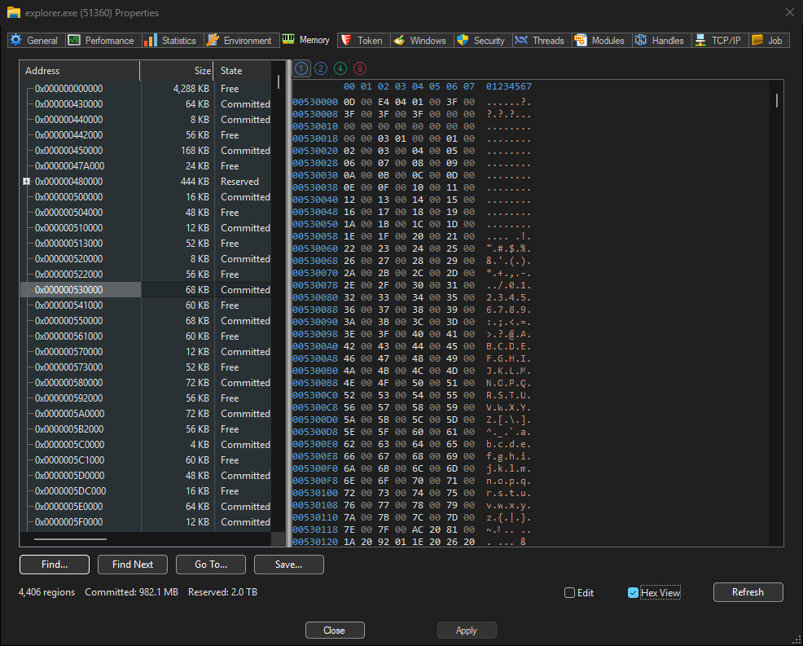

## Services

Every service, with its state, start type, process, account, description, binary path, dependencies, required
privileges and triggers (columns as in the other tabs). The filter matches the name, display name, description, process
and binary path.

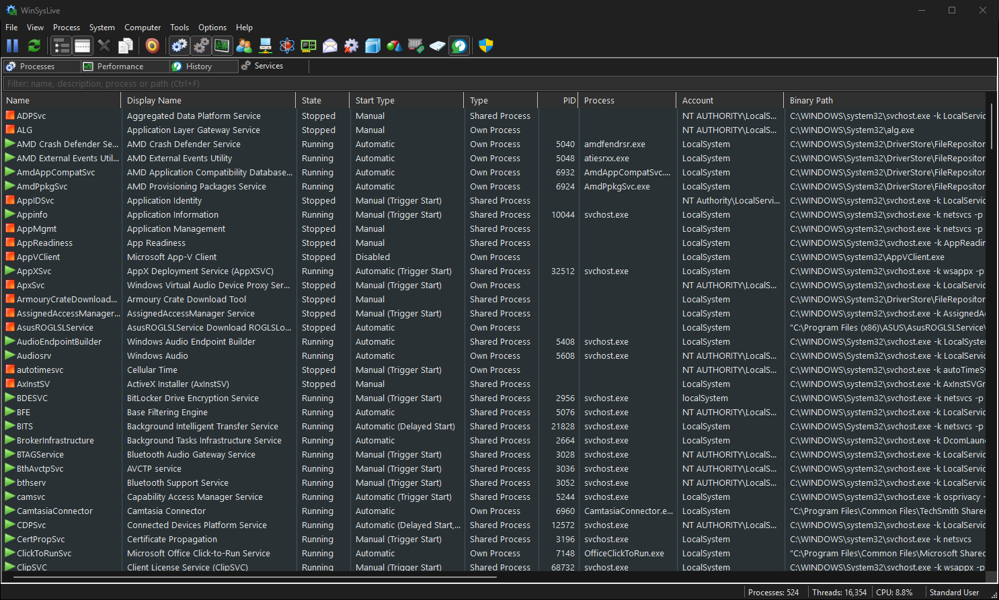

The context menu has **Start**, **Stop**, **Pause**, **Continue** and **Restart** (stopping and restarting the running
dependents too, after a confirmation that lists them), **Start Type** (Automatic, Automatic (Delayed Start), Manual,
Disabled), **Go to Process**, **New Service...**, **Delete Service** and **Properties**.

The **service properties** have the pages of the Services console and more: **General**, **Log On**, **Recovery**,
**Dependencies** (what the service depends on and what depends on it, as trees), **Triggers** and **Security**.
Changes are applied with OK or Apply.

## Performance

A list of resources on the left, each with a small graph, and the selected one's page on the right. The pages keep
their history while hidden.

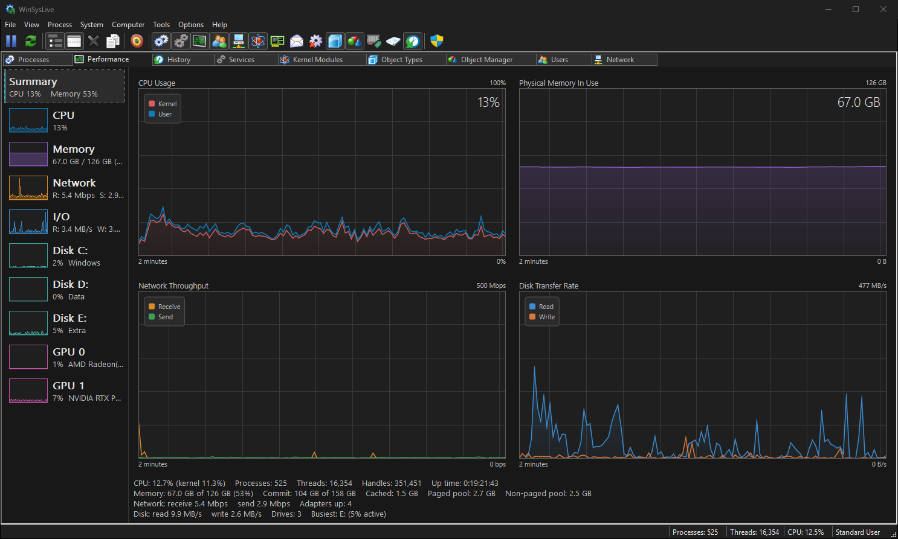

- **Summary:** CPU, memory, network and disk at a glance.
- **CPU:** total use (stacked: interrupts, DPCs, kernel, user), a graph per processor with its current frequency
  (uncheck **Show processors** to hide them), speed, interrupt and DPC rates. Hover over the graph to see the busiest
  processes at that time. On a hybrid processor (P- and E-cores, such as Intel's 12th generation and later), each
  processor's title says which kind of core it is, **(P)**, **(E)** or **(LP-E)** (low-power E-core), the E-cores'
  graphs are teal, and the text below counts the cores of each kind.
- **Memory:** use, commit, composition, and (on a wide enough page) the memory lists in detail: zeroed, free,
  modified, standby by priority.
- **Network:** a graph per active adapter.
- **I/O:** the system's read, write and other transfer rates.
- **Disk (one per drive):** read and write rates, active time and response time.
- **GPU and NPU (one per adapter):** a graph per engine, and dedicated and shared memory.

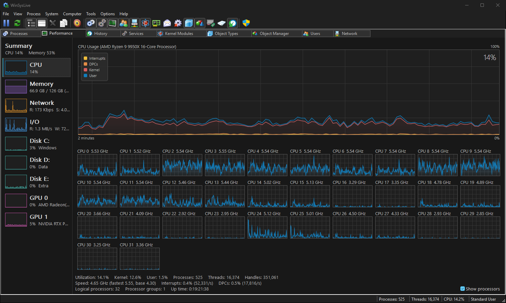

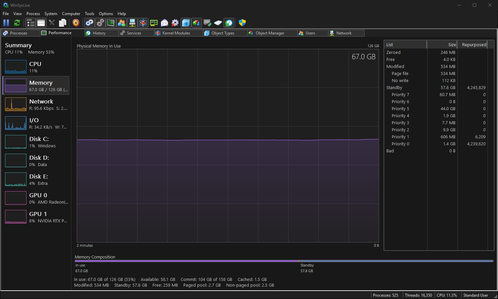

## Users

A row per session, with its user, state, client and logon time, and the session's processes under it, with totals per
session. **Disconnect** and **Log Off** in the context menu (after a confirmation).

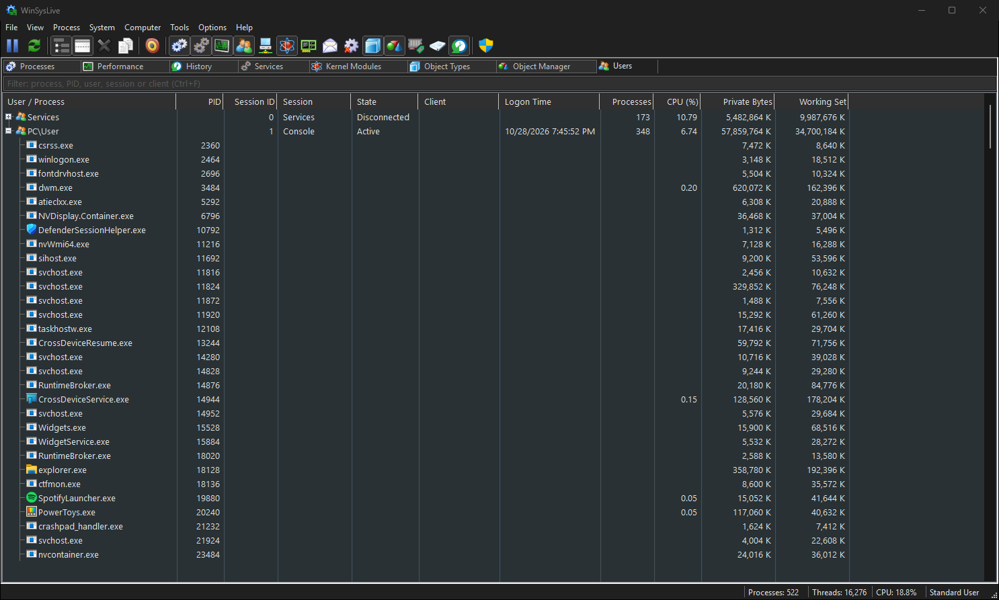

## Network

Every TCP connection and UDP endpoint, IPv4 and IPv6, with its process, addresses, ports and state. New connections are
green and closed ones red. When elevated, **Sent**, **Received** and their rates (hidden by default) show each
connection's traffic since the tab started tracking.

With **Options > Resolve Addresses** on, addresses show as DNS names (looked up in the background and cached). The
context menu has **Go to Process**, **Close Connection** (elevated; IPv4 TCP), **Resolve Again** and **Copy**.

## Kernel Modules

The drivers and other modules loaded in the kernel, with their base addresses (elevated), sizes, version information
and signature status. The context menu has **Properties**, **Open File Location**, **Go to Driver** (the driver service
that loaded it) and **VirusTotal**.

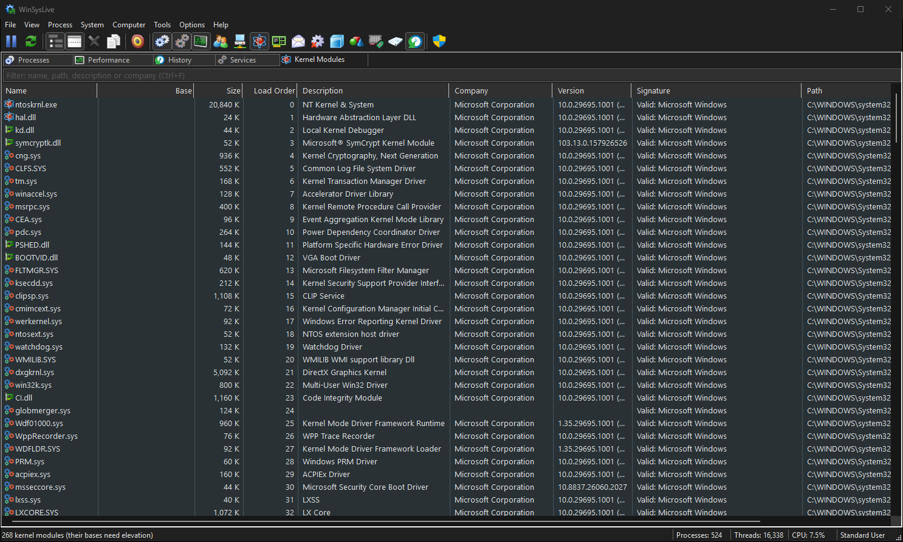

## Drivers

The driver services (kernel and file system drivers), as the Services tab shows services, with **Start Type** including
Boot and System, and **Go to Kernel Module** for a running driver.

## RPC/ALPC

Which processes talk to which (elevated): ALPC messages between client and server processes, and RPC calls by
interface (named where known), endpoint and protocol, with their counts and rates. Only traffic seen since the tab
opened shows. Double-click goes to the server or the client.

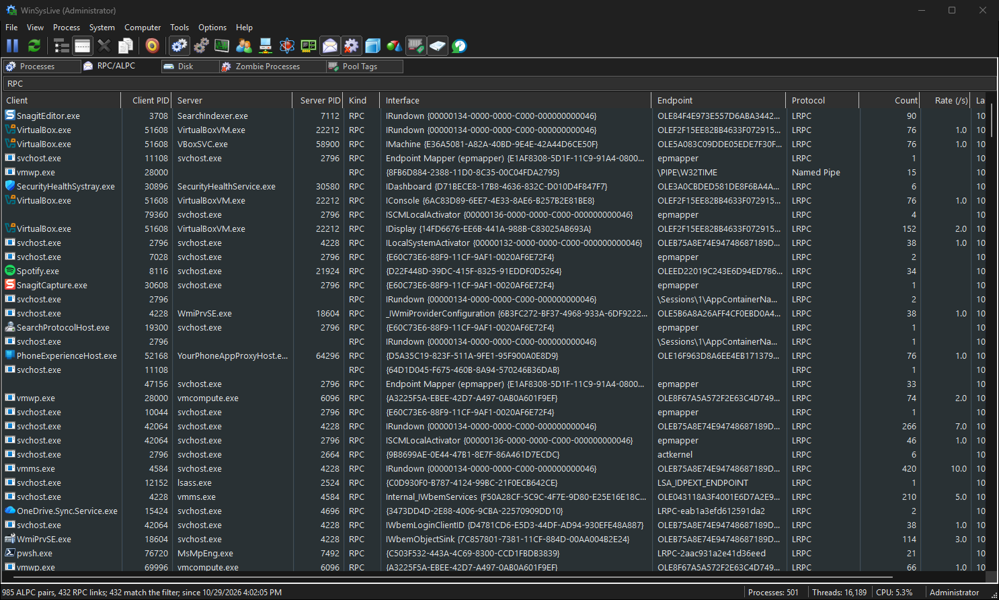

## Zombie Processes

Processes that have exited but are kept in memory because other processes still hold handles to them, with each
holder process, its handle count and access. **Show All Handles** lists every handle keeping a zombie, with **Close
Selected** and **Close All**; **Close Handles** and **Close All Handles** in the context menu close them directly.
Scanned every 5 seconds while the tab is active.

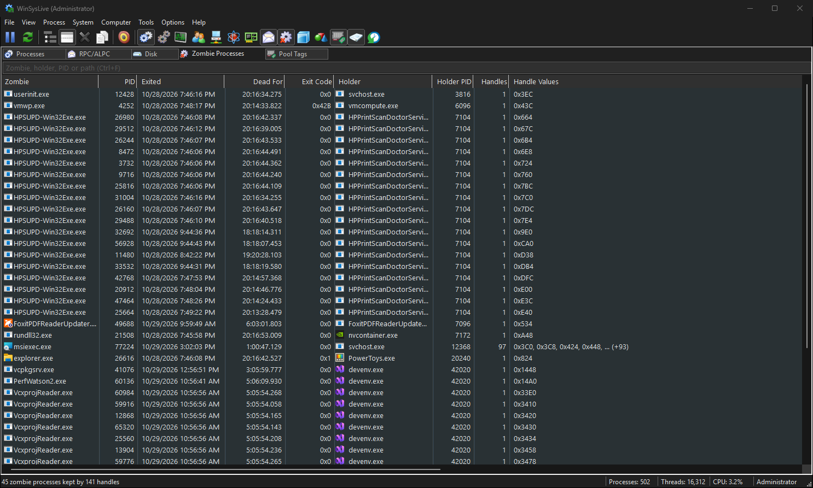

## Object Types

The kernel's object types with their object and handle counts (and peaks), pool type, default charges, valid access
and generic mapping. A count that changed since the last update is colored (green up, red down).

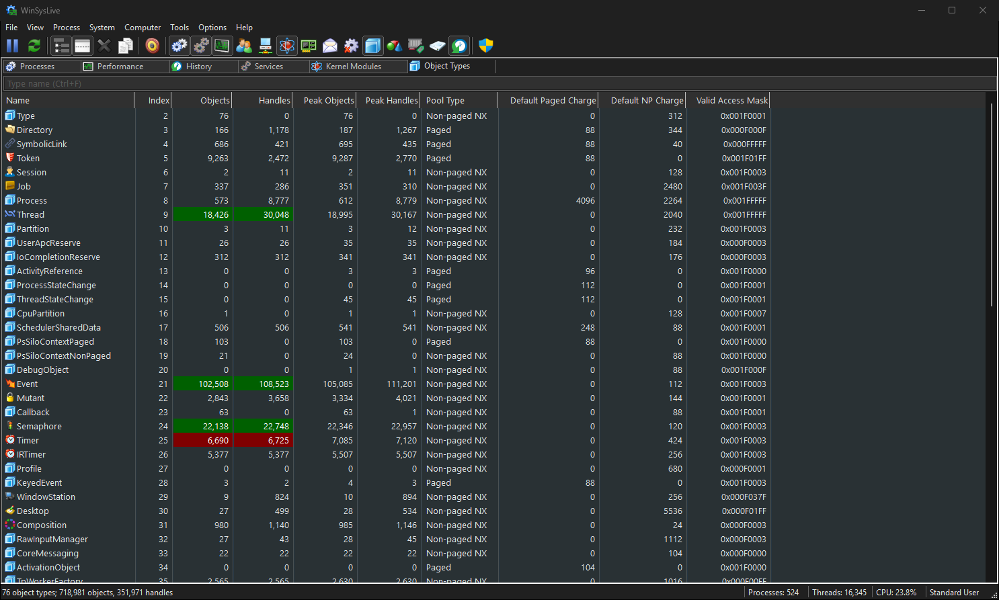

## Object Manager

The object manager namespace, as WinObj shows it: directories on the left and their objects on the right, with types,
symbolic link targets, creation times and handle counts. Double-click opens a directory, follows a symbolic link, or
opens an object's properties (the handle sheet). The last directory is reopened at startup.

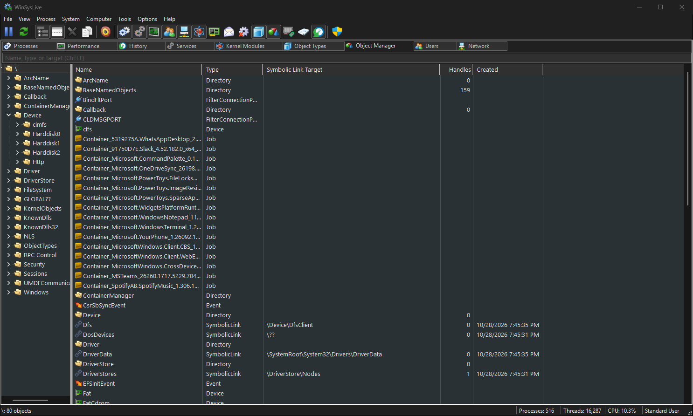

## Pool Tags

The kernel pools' use by tag (elevated): paged and non-paged allocations, frees, outstanding allocations and bytes,
with each tag's driver and description (from the Debugging Tools' `pooltag.txt` if installed, else the copy built
into WinSysLive). Changed values are colored.

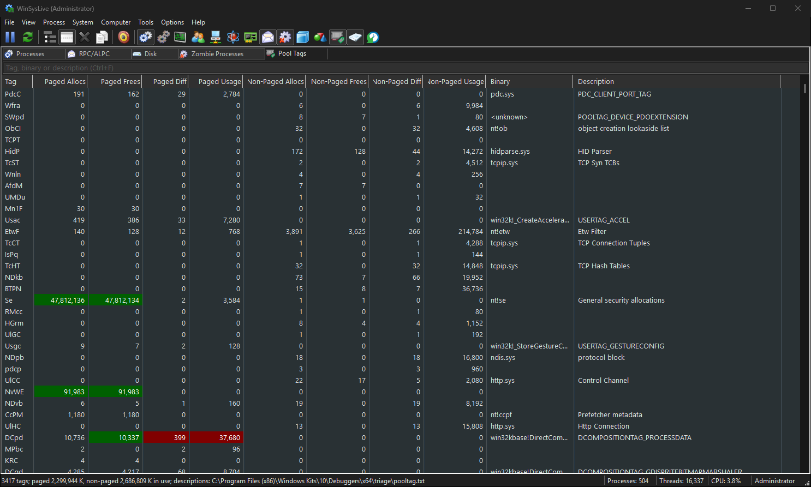

## Disk

File I/O per process and file (elevated): reads and writes, bytes and operations, and their rates. Files idle for a
minute drop off. **Go to Process**, **File Properties** and **Open File Location** in the context menu.

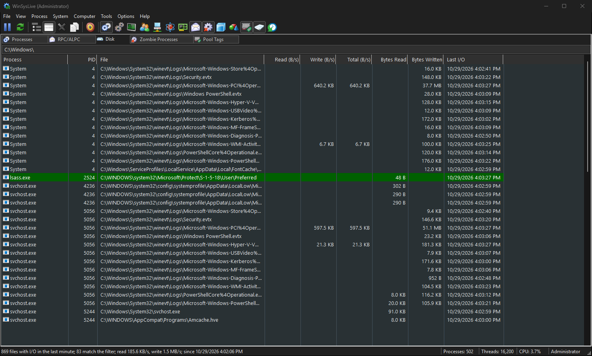

## History

A log of events while the tab is open: processes started (with parent, user and command line) and exited (with how
long they ran and the exit code), and services started, stopped, failed, paused, resumed, installed and deleted. The
log has its own filter, search (Ctrl+F) and level buttons. The context menu chooses the **Events** to log and has
**Go to Process**, **Copy**, **Save Log** (also Ctrl+S) and **Clear**.

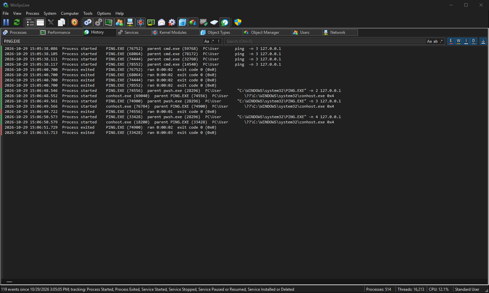

## Find Handle or DLL

**Process > Find Handle or DLL...** (Ctrl+Shift+F) searches every process for handles and loaded modules whose names
contain the text. Double-click a result to go to its process; **Properties** opens a handle's sheet.

## File menu: Run and Run As

- **Run...** (Ctrl+R) runs a command line as the shell does (a program, document, folder or URL), optionally
  elevated.
- **Run As...** runs a program as another user (with their profile, or with the credentials for network access only,
  as `runas /netonly`).
- **Run as Limited User...** runs a program without administrator rights, from an elevated WinSysLive.
- **Run as Administrator** restarts WinSysLive elevated.

## System menu

| Command | What it shows |
|---|---|
| Firmware and TPM... | Firmware type, Secure Boot, boot entries and order, the TPM; and (elevated) every UEFI variable with its value |
| Logon Sessions... | Every logon session with its user, type, package, time and server, and details |
| Page Files... | The page files in use, commit charge, the page file configuration and the swap file |
| Network Shares... | The local shares with their settings and share permissions |
| Pipes and Mailslots... | Every named pipe and mailslot |
| RAM... | Physical memory by use (process private, mapped files, page tables, pools...) and by list, as RAMMap (elevated; takes a few seconds) |
| Memory Lists | Empty Working Sets, Flush Modified List, Purge Standby List, Purge Low-Priority Standby List (elevated) |

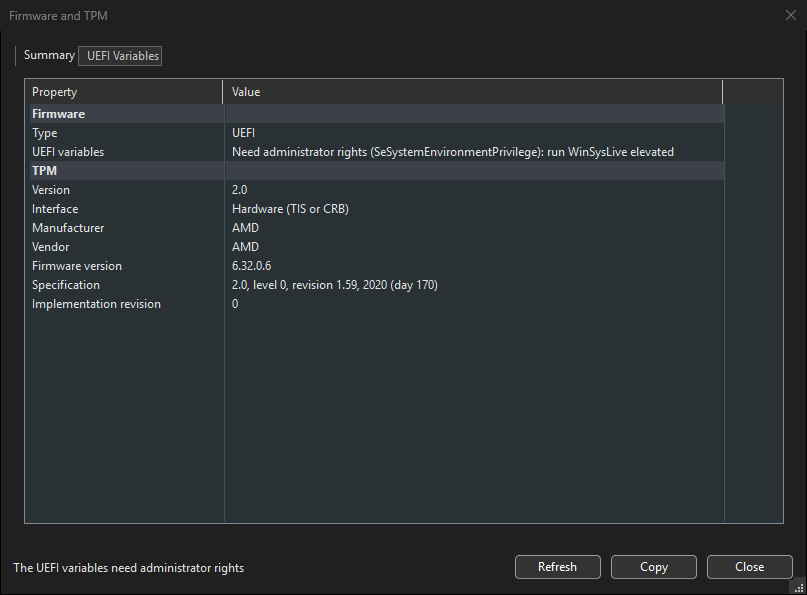

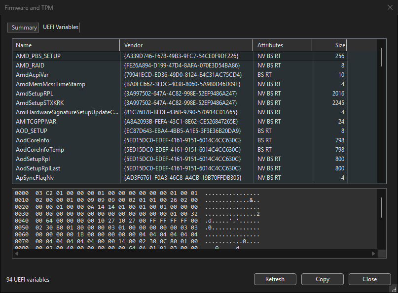

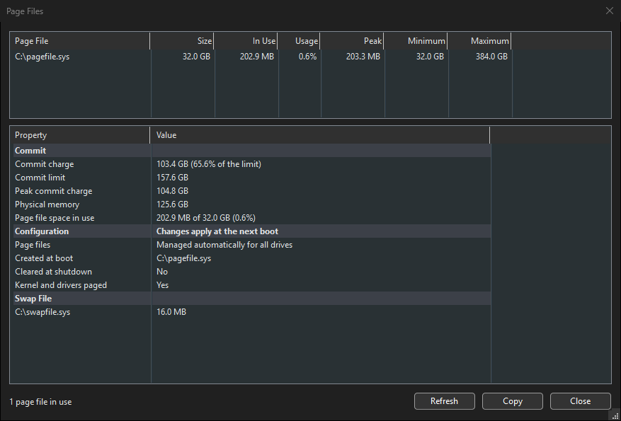

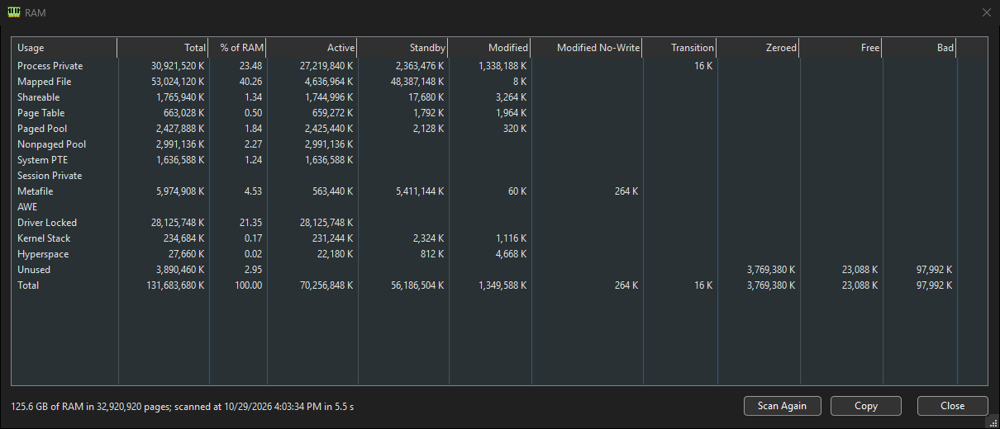

## Computer menu

Lock, Log Off, Sleep, Hibernate, Restart, Shut Down, **Restart to Boot Options** (Windows' advanced startup) and
**Restart to Firmware** (the UEFI setup; elevated). The commands that close programs ask first.

## Tools menu

**Install Driver/Service...** creates a service or a driver: name, display name, binary path, type, start type, error
control, account and dependencies, and optionally starts it.

## Options

| Option | What it does |
|---|---|
| Dark Mode | Switches between dark and light |
| Font... / Default Font | The font of the lists and trees |
| Process Colors... | The Processes tab's row colors per kind |
| Highlighting... | How long new and removed items stay highlighted, in seconds (0 turns it off) |
| Resolve Symbols / Symbol Settings... | See [Symbols](#symbols) |
| VirusTotal... | See [VirusTotal](#virustotal) |
| Resolve Addresses | Show network addresses as DNS names |
| Tray Icons... | Up to five notification area icons with small graphs: CPU, I/O, commit charge, physical memory, network. Click one to bring the window back; right-click for a menu |
| Minimize to Tray | A minimized window goes to the tray (while an icon is shown) |
| Always on Top | Keeps the window above others |
| Single Instance | Starting WinSysLive again brings the running instance to the front |
| Replace Task Manager | Starts WinSysLive instead of Task Manager (Ctrl+Shift+Esc, the taskbar's menu). Like Task Manager, it starts elevated without a UAC prompt; if it's already running, that instance comes to the front. Changing it needs elevation |
| Run at Windows Startup | Starts WinSysLive minimized when you sign in |
| Run at Windows Startup (Elevated) | The same, elevated without a UAC prompt (a scheduled task; changing it needs elevation) |
| Check for Updates at Startup | Checks once a day at most |
| Export Settings... / Import Settings... | Saves all settings to an INI file, or loads them (applied on restart) |

## Symbols

WinSysLive resolves addresses (thread start addresses, call stacks) to symbols. **Options > Symbol Settings...** sets
the symbol path: extra local paths, `_NT_SYMBOL_PATH`, and a symbol server with its local cache (the Microsoft symbol
server by default). **Options > Resolve Symbols** turns resolution off, showing addresses only. Downloading symbols
needs `dbghelp.dll` and `symsrv.dll` beside the exe.

A thread's **Stack** shows each frame with its module and where its symbols came from; double-click a frame to open
its module's folder.

## VirusTotal

The **VirusTotal** column (Processes, Modules, Kernel Modules; hidden by default) shows each file's detections, such as
`0/72`. Files are looked up by their SHA-256 hash; nothing is uploaded unless you choose **Submit File...**, which
asks first, as VirusTotal shares submitted files with its partners.

Lookups need a VirusTotal API key (free from virustotal.com): enter it in **Options > VirusTotal...**, with the number
of requests a minute (4 for the free API). The key is stored encrypted for your account. **Open Report** opens the
file's page on virustotal.com and needs no key.

## Updates

**Help > Check for Updates...** compares the version with the latest GitHub release. If there's a newer one,
**Download and Install** downloads it, verifies its signature, installs it beside the current exe and restarts.
When installed with WinGet, update with `winget upgrade ScorpioSoftware.WinSysLive` instead.

## Keyboard shortcuts

| Keys | Command |
|---|---|
| Ctrl+1 ... Ctrl+9, Ctrl+0 | Processes, Services, Performance, Users, Network, Kernel Modules, Drivers, RPC/ALPC, Zombie Processes, Object Types |
| Ctrl+Shift+O / P / D / H | Object Manager, Pool Tags, Disk, History |
| Ctrl+T | Process tree / flat list |
| Ctrl+L | Lower pane |
| F5 | Refresh |
| Space | Pause or resume updates |
| Ctrl+F | Focus the filter box |
| Ctrl+Shift+F | Find Handle or DLL |
| Ctrl+C | Copy |
| Ctrl+Shift+C | Copy all rows |
| Ctrl+S | Export list |
| Ctrl+R | Run |
| Delete | Kill process / terminate thread / close handle |
| Alt+Enter | Properties |
| Escape | Clear the filter |
| Ctrl+F, F3, Ctrl+G | Find, Find Next and Go To in the Memory page's hex view |

## What needs elevation

Without elevation, WinSysLive still shows your own processes in full and the rest in part. These need it to run
elevated:

- Details of other users' and system processes (columns, threads' start addresses, handles, memory)
- Kernel object addresses in handle lists, and zombie processes held by other users' processes
- Network traffic per process and connection, Close Connection
- The RPC/ALPC, Pool Tags and Disk tabs
- Kernel module base addresses
- UEFI variables and Restart to Firmware
- RAM and Memory Lists
- Critical Process
- Replace Task Manager and Run at Windows Startup (Elevated) (to change them)
